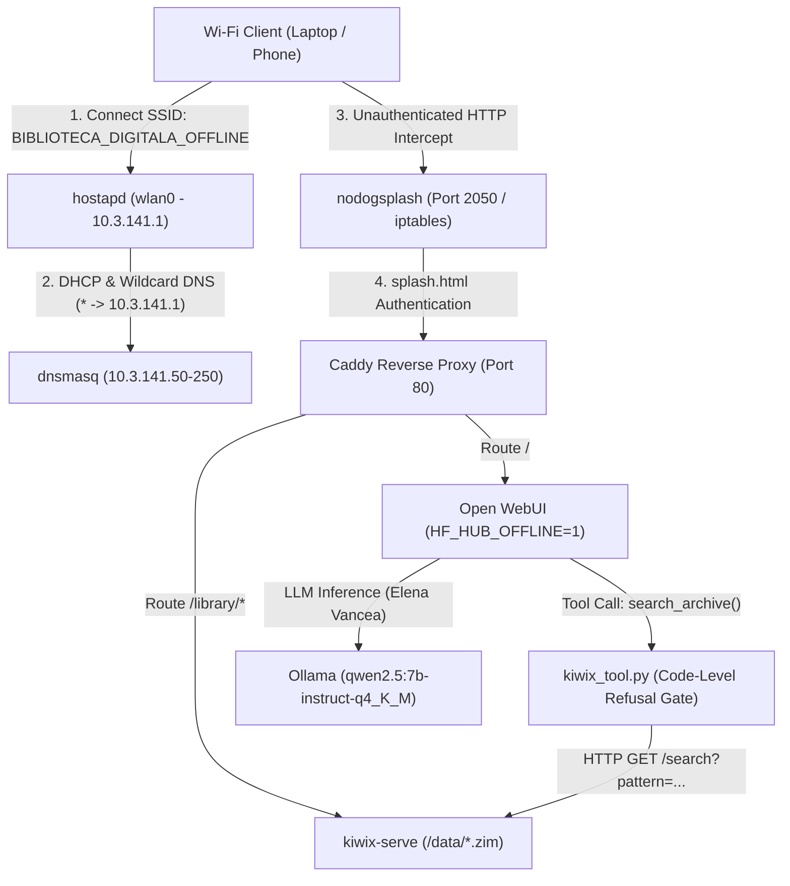

# Offline Resilience Knowledge Vault

A 100% air-gapped, self-contained digital library and technical AI assistant designed for x86-64 Linux Mini PCs and single-board computers. The system exposes an autonomous Wi-Fi Access Point (`BIBLIOTECA_DIGITALA_OFFLINE`) with a Captive Portal routing users to a massive local repository of **Kiwix ZIM archives** and a strictly grounded local LLM persona (**Elena Vancea — Executive Secretary & Head of Documentary Holdings**).

---

## Architecture Overview



### Key Capabilities
- **100% Air-Gapped Operation**: `Open WebUI` runs with `HF_HUB_OFFLINE=1`, `TRANSFORMERS_OFFLINE=1`, `OFFLINE_MODE=true`, `ENABLE_OPENAI_API=false`, and `ENABLE_SIGNUP=false`.
- **Two-Layer Anti-Hallucination Defense**:
  1. **Code-Level Refusal Gate** (`tools/kiwix_tool.py`): Queries `http://kiwix-serve:8080/search?pattern=...` before generation. If HTTP status != 200 or 0 articles match, it returns `STATUS_DOCUMENT_INEXISTENT: Subiectul nu se află în arhivele locale.`.
  2. **System Prompt Protocol** (`Modelfile`): Configured with `temperature 0.2`, `top_p 0.8`, `num_ctx 8192`, and strict documentary citation rules.
- **Zero-Touch Provisioning**: `scripts/provision_openwebui.py` automatically creates the local admin account, injects `kiwix_tool.py` directly into Open WebUI's SQLite database (`webui.db`), and binds the tool to the `elena-vancea:latest` model profile.
- **Autonomous Wi-Fi & Captive Portal**: `hostapd` + `dnsmasq` + `nodogsplash` serve an open AP (`BIBLIOTECA_DIGITALA_OFFLINE`) on `10.3.141.0/24` with DNS hijacking (`captive.apple.com`, `connectivitycheck.gstatic.com`, etc. -> `10.3.141.1`) and a custom `splash.html` portal.

---

## Directory Structure

```text
knowledge-vault/
├── Caddyfile                     # Reverse proxy routing / -> Open WebUI and /library/* -> Kiwix
├── docker-compose.yml            # Container orchestration (kiwix-serve, ollama, open-webui, caddy)
├── install.sh                    # Master Click-to-Install TUI & Automated Setup script
├── Modelfile                     # Primary Ollama Modelfile (qwen2.5:7b-instruct-q4_K_M)
├── Modelfile.fallback            # Fallback Ollama Modelfile for low-RAM systems (3b-instruct-q4_K_M)
├── README.md                     # Technical documentation and usage guide
├── uninstall.sh                  # Symlink to scripts/uninstall.sh
├── network/
│   ├── dnsmasq.conf              # DHCP server (10.3.141.50-250) + wildcard DNS hijack
│   ├── hostapd.conf              # Open Wi-Fi AP (SSID: BIBLIOTECA_DIGITALA_OFFLINE)
│   ├── nodogsplash.conf          # Captive Portal firewall and redirect configuration
│   └── splash.html               # Captive Portal UI with quick-access buttons
├── scripts/
│   ├── download_assets.sh        # Whiptail TUI selective ZIM & low-level archive downloader
│   ├── init_ollama_model.sh      # Pulls GGUF model and builds elena-vancea:latest in Ollama
│   ├── network_ap_control.sh     # Switches wlan0 between Internet Client and Air-Gapped AP mode
│   ├── provision_openwebui.py    # Zero-touch SQLite/API provisioner for Open WebUI & kiwix_tool.py
│   ├── setup_host.sh             # Installs host packages, checks filesystem, configures Docker
│   ├── uninstall.sh              # Clean reset / uninstall utility for testing
│   └── verify_stack.sh           # End-to-end automated verification suite (Phases 1-7)
├── storage/
│   ├── caddy_data/               # Persistent Caddy state
│   ├── ollama_data/              # Persistent Ollama GGUF weights and manifests
│   ├── openwebui_data/           # Persistent Open WebUI database (webui.db) & admin credentials
│   └── zim_files/                # ZIM archives (*.zim) and raw low-level mirrors
└── tools/
    └── kiwix_tool.py             # Open WebUI native Python tool with Code-Level Refusal Gate
```

---

## Quick Start ("Click-to-Install")

### Option 1: Interactive TUI Control Center (Recommended)
Run the master installer from the terminal (or double-click `Offline-Knowledge-Vault-Setup.desktop` in a desktop file manager):

```bash
/home/aspekt/bunker-library/install.sh
```

From the `whiptail` menu you can:
1. Run the **Full Automated Install** (configures host packages, seeds an initial ZIM, starts Docker Compose, compiles `elena-vancea:latest`, provisions Open WebUI's database, enables `systemd` autostart, and runs all verification checks).
2. Run the **Full Install with 3B Fallback Model** for low-memory hardware (< 6.5 GB RAM).
3. Launch the **Selective ZIM Archive Downloader**.
4. Start/Restart the Docker stack.
5. Enable or Disable the **Air-Gapped Wi-Fi Access Point**.
6. Run the **Verification Suite**.
7. **Uninstall / Reset Environment** for clean testing.

### Option 2: Unattended One-Command Install (`--auto`)
To execute the entire 6-stage provisioning pipeline non-interactively:

```bash
/home/aspekt/bunker-library/install.sh --auto
```

To force the lightweight 3B fallback model in unattended mode:

```bash
/home/aspekt/bunker-library/install.sh --auto --fallback-3b
```

---

## Usage Guide

### 1. Downloading ZIM Archives & Low-Level Documentation
While connected to the internet, launch the selective downloader:

```bash
/home/aspekt/bunker-library/knowledge-vault/scripts/download_assets.sh
```

The TUI checklist displays the available disk space on `storage/zim_files/` and lets you select:
- **Wikipedia**: Romanian Maxi (~8 GB), Romanian Nopic (~3.5 GB), English Maxi (~111 GB), English Nopic (~56 GB), Top 10 Major Languages Nopic (~230 GB), or All Languages Nopic (~500 GB via regex catalog parser).
- **Low-Level Engineering**:
  - `syscall.sh` JSON API tables (`x64`, `x86`, `arm64`, `arm`, `riscv64`) + ZIM packaging via `ghcr.io/openzim/zimit`.
  - **Felix Cloutier x86 Instruction Set Manual** (clean local mirror via `wget` + optional ZIM build).
  - **OSDev.org Wiki ZIM** (~350 MB) and **DevDocs Core ZIMs** (~4 GB).
- **Technical & Survival**: Stack Overflow (~120 GB), iFixit (~4 GB), WikiMed Medical Encyclopedia (~2 GB), OpenStreetMap Wiki (~40 GB).

All large downloads use `aria2c -c -x 8 -s 8 -j 4` for multi-connection parallel downloading and automatic resume if interrupted.

After downloading new `.zim` files, refresh Kiwix Serve:

```bash
docker restart vault-kiwix
```

---

### 2. Accessing Services (Localhost & Wi-Fi AP)

| Service | Local URL | Air-Gapped Wi-Fi AP URL |
| :--- | :--- | :--- |
| **Elena Vancea AI (Open WebUI)** | `http://localhost/` | `http://10.3.141.1/` |
| **Kiwix ZIM Digital Library** | `http://localhost/library/` | `http://10.3.141.1/library/` |
| **Kiwix Search API** | `http://localhost/library/search?pattern=linux` | `http://10.3.141.1/library/search?pattern=linux` |

> **Default Open WebUI Admin Credentials**:
> Generated automatically on first run and saved in `storage/openwebui_data/ADMIN_CREDENTIALS.txt`:
> - **Email**: `elena.vancea@biblioteca.local`
> - **Password**: `BibliotecaOffline2026!`

---

### 3. Switching Between Internet Mode and Air-Gapped Wi-Fi AP Mode

To prevent losing internet connectivity while downloading models and ZIM archives, the Wi-Fi interface (`wlan0`) remains in standard client mode during setup.

- **Activate Air-Gapped Wi-Fi Access Point (`BIBLIOTECA_DIGITALA_OFFLINE`)**:
  ```bash
  sudo /home/aspekt/bunker-library/knowledge-vault/scripts/network_ap_control.sh --start
  ```
  This detaches `wlan0` from `NetworkManager`, assigns static IP `10.3.141.1/24`, and starts `hostapd`, `dnsmasq`, and `nodogsplash`. Connecting any phone or laptop to `BIBLIOTECA_DIGITALA_OFFLINE` automatically triggers the Captive Portal (`splash.html`).

- **Return to Standard Wi-Fi Client Mode (Internet)**:
  ```bash
  sudo /home/aspekt/bunker-library/knowledge-vault/scripts/network_ap_control.sh --stop
  ```

- **Check Network Status**:
  ```bash
  /home/aspekt/bunker-library/knowledge-vault/scripts/network_ap_control.sh --status
  ```

---

## Verification & Testing

Run the automated verification suite at any time to validate all 7 phases (filesystem, CLI tools, `Modelfile`, directory structure, `download_assets.sh`, Caddy reverse proxy routes, Kiwix API, `kiwix_tool.py` refusal gate, and AP configs):

```bash
/home/aspekt/bunker-library/knowledge-vault/scripts/verify_stack.sh
```

---

## Uninstalling / Resetting the Environment for Clean Testing

Use `uninstall.sh` to clean the environment before testing a fresh installation:

```bash
# Interactive TUI menu (choose Fast Reset, Full Reset, or Deep Purge):
/home/aspekt/bunker-library/uninstall.sh

# Fast Reset: stops Docker & AP, removes systemd service & /etc configs, wipes Open WebUI DB,
# but KEEPS downloaded ZIM files and Ollama models for fast re-testing:
/home/aspekt/bunker-library/uninstall.sh --fast

# Full 100% Reset: wipes ALL data in storage/ (including ZIMs and Ollama models), containers, and /etc configs:
/home/aspekt/bunker-library/uninstall.sh --full-reset

# Deep Purge: Full 100% Reset + deletes all locally pulled Docker images:
/home/aspekt/bunker-library/uninstall.sh --deep-purge
```
